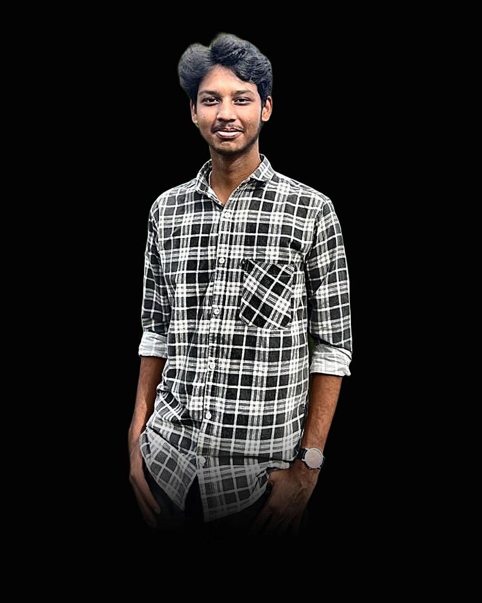

<div align="center">

  

  <h1 align="center">Rama Sri Surya</h1>

  <p align="center">
    <strong>AI &amp; Autonomous Systems Engineer &bull; 3x Consecutive Hackathon Champion</strong><br>
    <em>Undergraduate in Computer Science &amp; Engineering @ Amrita Vishwa Vidyapeetham, Kollam (Class of 2029)</em>
  </p>

  <p align="center">
    <a href="https://kramasrisurya.github.io/portfolio/"></a>
    &nbsp;
    <a href="https://linkedin.com/in/rama-sri-surya"></a>
    &nbsp;
    <a href="https://kramasrisurya.github.io/portfolio/RAMA_SRI_SURYA_ATS_RESUME.pdf"></a>
    &nbsp;
    <a href="mailto:kramasrisurya@gmail.com"></a>
  </p>

  <p align="center">
    <a href="https://github.com/kramasrisurya">
      
    </a>
  </p>

</div>

---

### 🏛️ Executive Profile &amp; Engineering Philosophy

I am an **AI and Autonomous Systems Engineer** focused on building verifiable agentic reasoning pipelines, real-time spatial computer vision systems, and resilient asynchronous backends.

Rather than wrapping stochastic LLM prompts in fragile scripts, I architect **deliberative multi-agent consensus graphs** with strict domain constraints, paired with **sub-millisecond distributed state stores (FastAPI + Redis AsyncIO)** and **deep neural networks (PyTorch, ResNet50, OpenCV)**.

- 🎓 **Undergraduate**: B.Tech in CSE at **Amrita Vishwa Vidyapeetham**, Kollam (Class of 2029)
- 🏆 **Track Record**: **3x Consecutive Inter-College Hackathon Champion** (Sem 1, Sem 2, Sem 3)
- 📜 **Specialization**: AIML Certification Program &mdash; **IIT Patna**
- 📍 **Base**: Visakhapatnam / Kollam, India
- 🎯 **Focus Areas**: Deliberative Agents &bull; Spatial Vision &amp; ReID &bull; Production GenAI Orchestration

```
┌─────────────────────────────────────────────────────────────────────────────┐
│ 01. Reasoning Over Reflex   → Multi-agent consensus loops > single-shot LLMs│
│ 02. Spatial Grounding       → Sub-ms Redis state caching + Deep Person ReID │
│ 03. Production Rigor        → Pydantic v2 schemas + Pytest + Multi-stage CI │
└─────────────────────────────────────────────────────────────────────────────┘
```

---

### 🏆 Championship Honors &amp; Accolades

| Semester / Event | Placement | Host Institution | Project Focus |
|:---|:---:|:---|:---|
| **Semester 3 (2026)** | 🥇 **1st Place** | **IIIT Kottayam Inter-College Hackathon** | Distributed intelligent systems under 36h sprint constraints |
| **Semester 2 (2026)** | 🥇 **1st Place** | **Epochon 2.0 Agentic AI Hackathon** | OmniBots / S2 Legal AI: Multi-agent statutory consensus engine |
| **Semester 1 (2025)** | 🥇 **1st Place** | **Amrita Freshman Hackathon** | High-velocity modular software engineering &amp; algorithm design |

---

### 🚀 Featured Production Systems

#### 1. [OmniBots / S2 Deliberative Legal AI](https://github.com/kramasrisurya/s2-legal-ai)
> **Autonomous Multi-Agent Deliberative Reasoning Engine**  
> *Won 1st Place at Epochon 2.0*
- **Architecture**: Tri-agent consensus DAG featuring intake routing, statutory analysis, adversarial boundary cross-auditing, and synthesis arbiter.
- **Capabilities**: Zero-hallucination verification loops for statutory filing deadlines, cross-jurisdictional compliance, and structured document triage.
- **Stack**: Python, FastAPI, Google Gemini API (`@google/genai`), Pydantic v2 schemas, Redis AsyncIO, Docker.

#### 2. [SmartRetail_AI — Spatial Vision &amp; Retail Risk Engine](https://github.com/kramasrisurya/SmartRetail_AI)
> **Autonomous Multi-Camera Person Re-Identification (Person ReID) &amp; Telemetry**
- **Architecture**: Deep feature extraction embeddings across non-overlapping camera fields of view to track customer trajectories and loss-prevention vectors in real time.
- **Performance**: Sub-millisecond state caching via Redis AsyncIO and non-blocking event-loop processing.
- **Stack**: Python, PyTorch, TorchVision, OpenCV, FastAPI, Redis, Docker, Pydantic.

#### 3. [Educraft.ai — Multimodal GenAI Engine](https://github.com/kramasrisurya/Educraft.ai)
> **Deterministic Multimodal PDF-to-Interactive-Course Generator**
- **Architecture**: Structured output schema enforcement via Gemini 1.5/2.0 Flash to convert dense academic PDFs into modular curricula, interactive flashcards, and verified assessments.
- **Stack**: TypeScript, Google Gemini API, React 19, Supabase SSR, Tailwind CSS, Vite.

#### 4. [MNIST Deep CNN &amp; Real-Time Inference Canvas](https://github.com/kramasrisurya/mnist_digit_recognition)
> **Convolutional Neural Network with Interactive Stroke Recognition**
- **Performance**: **&gt;98% classification benchmark** on MNIST test suite with instant browser stroke normalization.
- **Stack**: Python, PyTorch, Keras 3, Streamlit Drawable Canvas, NumPy, Matplotlib.

#### 5. [Editorial Portfolio 2.0](https://github.com/kramasrisurya/portfolio)
> **Award-Winning Luxury Editorial Portfolio &amp; Telemetry Hub**
- **Features**: Three.js WebGL GLSL shader wave lattice, 2D particle fallback, Lenis smooth scrolling, GSAP ScrollTrigger, ATS Resume modal, and dark editorial typography.
- **Stack**: React 19, TypeScript, Vite 8, Three.js, GSAP, Tailwind CSS, GitHub Pages CI/CD.

---

### 🛠️ Technical Stack &amp; Toolchain

<table>
  <tr>
    <td width="25%" valign="top"><strong>Generative AI &amp; Agents</strong></td>
    <td>
      
      
      
      
      
    </td>
  </tr>
  <tr>
    <td valign="top"><strong>Deep Learning &amp; Vision</strong></td>
    <td>
      
      
      
      
      
      
    </td>
  </tr>
  <tr>
    <td valign="top"><strong>Backend &amp; Distributed</strong></td>
    <td>
      
      
      
      
      
      
    </td>
  </tr>
  <tr>
    <td valign="top"><strong>Languages &amp; Core</strong></td>
    <td>
      
      
      
      
      
      
    </td>
  </tr>
</table>

---

### 📜 Verified Industry Certifications

- 🏅 **AIML Certification Program** &mdash; *Indian Institute of Technology (IIT), Patna*
- 🏅 **AWS Cloud Practitioner Essentials** &mdash; *Amazon Web Services (AWS)*
- 🏅 **Computer Vision with Azure Cognitive Services** &mdash; *Microsoft*
- 🏅 **Artificial Intelligence for All** &mdash; *Infosys Springboard*
- 🏅 **Generative AI For All** &mdash; *Infosys Springboard*
- 🏅 **Data Analytics Job Simulation** &mdash; *Deloitte (via Forage)*
- 🏅 **Data Science &amp; Analytics** &mdash; *HP LIFE*

---

### 📊 Real-Time GitHub Telemetry

<p align="center">
  
  &nbsp;
  
  &nbsp;
  
</p>

<p align="center">
  
</p>

---

### 📬 Direct Transmission

<p align="center">
  <a href="https://kramasrisurya.github.io/portfolio/">
    
  </a>
  &nbsp;
  <a href="https://www.linkedin.com/in/rama-sri-surya">
    
  </a>
  &nbsp;
  <a href="mailto:kramasrisurya@gmail.com">
    
  </a>
</p>

<p align="center">
  <em>Obsessed with engineering depth, mathematical rigor, and real-world execution.</em>
</p>
